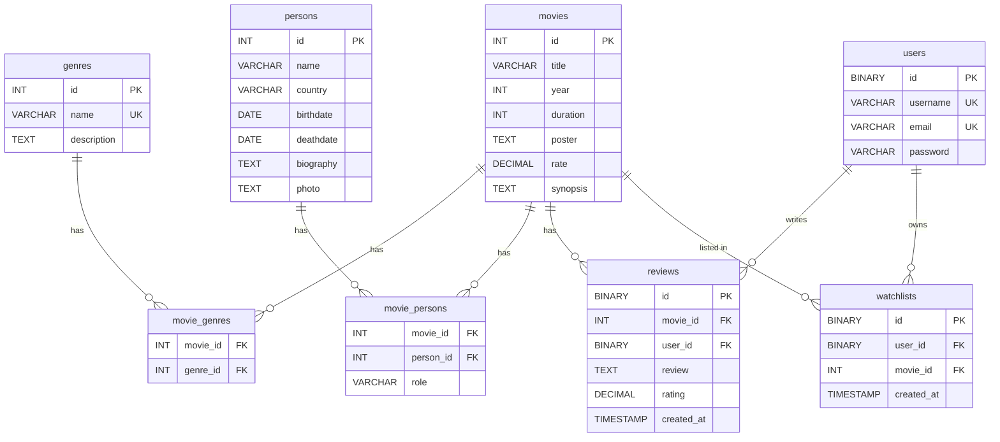

# 🎬 Movies API

A RESTful API for managing a movie catalog, built with **Express 5** and **MySQL 8**.

## Tech Stack

| Layer | Technology |
|---|---|
| Runtime | Node.js (ESM) |
| Framework | Express 5 |
| Database | MySQL 8.0 |
| Validation | Zod 4 |
| Containerization | Docker Compose |
| DB Admin (optional) | phpMyAdmin |

## Project Structure

```
MoviesApi/
├── app.js                  # Express app factory
├── server.js               # Entry point – boots the app with the MySQL model
├── config/
│   └── db.js               # MySQL connection (mysql2/promise)
├── controllers/
│   └── movies.controller.js # Request handlers (CRUD)
├── database/
│   ├── database.sql        # Schema + seed data (15 movies, 10 genres)
│   └── seed.js             # Seed endpoint logic
├── middleware/
│   └── middleware.js        # CORS headers
├── models/
│   └── movies.model.js     # Data-access layer (raw SQL queries)
├── routes/
│   └── movie.routes.js     # Route definitions
├── schemas/
│   └── movie.schema.js     # Zod validation schemas
├── utils/
│   └── isObjectEmpty.utils.js
├── views/
│   └── index.html
├── docker-compose.yaml
└── package.json
```

## Getting Started

### Prerequisites

- **Node.js** ≥ 18
- **Docker** & **Docker Compose** (for the database)
- **pnpm** (or npm/yarn)

### 1. Clone & install

```bash
git clone <repo-url>
cd MoviesApi
pnpm install
```

### 2. Environment variables

Create a `.env` file in the project root:

```env
MYSQL_HOST=localhost
MYSQL_PORT=3306
MYSQL_ROOT_PASSWORD=rootpassword
MYSQL_DATABASE=movie_api_db
MYSQL_USER=movieuser
MYSQL_PASSWORD=moviepassword
PMA_PORT=8080
PORT=1313
```

### 3. Start the database

```bash
docker compose up -d
```

> [!TIP]
> Need phpMyAdmin? Launch it with `docker compose --profile debug up -d` — it'll be available at `http://localhost:8080`.

### 4. Create tables & seed data

Run the SQL in `database/database.sql` against your MySQL instance, or hit the seed endpoint after the server starts:

```
GET /seed
```

### 5. Run the server

```bash
pnpm dev
```

The API starts on **http://localhost:1313** (or whatever `PORT` you set).

## API Endpoints

All routes are prefixed with `/movies`.

| Method | Endpoint | Description |
|---|---|---|
| `GET` | `/movies` | List all movies (supports query filters) |
| `GET` | `/movies/:id` | Get a single movie by UUID |
| `POST` | `/movies` | Create a new movie |
| `PATCH` | `/movies/:id` | Partially update a movie |
| `DELETE` | `/movies/:id` | Delete a movie |

### Query Filters (`GET /movies`)

| Param | Type | Example | Behavior |
|---|---|---|---|
| `genre` | string | `?genre=Action` | Filter by genre (joins `genres` table) |
| `year` | int | `?year=1994` | Exact year match |
| `rate` | float | `?rate=8.5` | Minimum rating (`>=`) |
| `duration` | int | `?duration=142` | Exact duration match |

### Request Body (POST / PATCH)

Validated with Zod. All fields required on `POST`; any subset accepted on `PATCH`.

```json
{
  "title": "Inception",
  "year": 2010,
  "director": "Christopher Nolan",
  "duration": 148,
  "rate": 8.8,
  "poster": "https://example.com/poster.jpg",
  "genre": ["Action", "Adventure", "Sci-Fi"]
}
```

#### Field constraints

| Field | Type | Rules |
|---|---|---|
| `title` | string | min length 1 |
| `year` | integer | 1900 – current year |
| `director` | string | min length 1 |
| `duration` | integer | positive |
| `rate` | number | 0 – 10 |
| `poster` | string | valid URL |
| `genre` | string[] | `Action`, `Comedy`, `Drama`, `Horror`, `Sci-Fi`, `Romance` |

### Response Examples

**200 – Single movie**
```json
{
  "id": "a1b2c3d4-...",
  "title": "The Dark Knight",
  "year": 2008,
  "director": "Christopher Nolan",
  "duration": 152,
  "poster": "https://...",
  "rate": 9.0
}
```

**400 – Validation error**
```json
{ "message": "..." }
```

**404 – Not found**
```json
{ "success": false, "message": "Movie not found" }
```

## Database Schema



## Architecture

The app uses a **dependency-injection** pattern — the model class is passed into the app factory, making it straightforward to swap the data source (e.g., swap MySQL for an in-memory store for testing).

```
server.js  ──▶  createApp({ moviesModel })
                    │
                    ├── middleware (CORS)
                    ├── /movies  ──▶  MoviesController  ──▶  MoviesModel  ──▶  MySQL
                    └── /seed
```

## License

ISC
